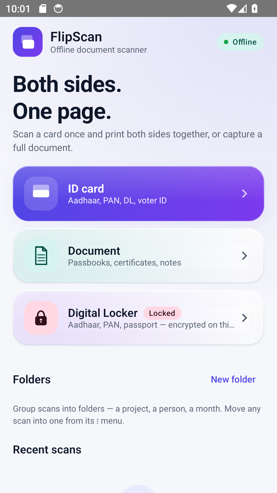

# FlipScan

An offline document scanner for Android. Scan **both sides** of an ID card (Aadhaar, PAN, driving
licence, voter ID, college ID) onto **one page**, or capture a normal multi-page document and export
it as PDF, JPG or PNG.

<p align="center">
  
</p>

- **No network code at all** — the app does not declare the `INTERNET` permission
- No ads, no analytics, no accounts, no cloud
- Scans stay in app-private storage until you export them
- Sensitive documents can be kept in an encrypted Digital Locker behind your phone's own screen lock
- MIT licensed

## Contents

- [Features](#features)
- [Privacy and offline design](#privacy-and-offline-design)
- [Technology](#technology)
- [Build](#build)
- [Measured build sizes](#measured-build-sizes)
- [Project layout](#project-layout)
- [Digital Locker](#digital-locker)
- [Digital Pins](#digital-pins)
- [Testing](#testing)
- [Known limitations](#known-limitations)
- [Version](#version)
- [License](#license)

## Features

**Capture**
- **Double Side mode** — FRONT and BACK slots laid out as they will print, with a live preview that
  slides between slots and tap-to-retake per slot. Standard card size 85.6 × 54 mm.
- **Document mode** — many pages, free-form edge detection and crop, reorder and delete.
- **OpenCV edge detection** — downscaled frames, every third frame, on a background thread,
  latest-frame-only. Grayscale → blur → Canny → largest quadrilateral, with the perspective warp
  applied to the full-resolution photo. Corner overlay, auto-capture after roughly a second of
  steady framing, and blur/glare warnings.
- **Flash / torch** — a continuous torch toggle on both camera screens, driven by CameraX
  `cameraControl.enableTorch` and mirroring the camera's real `TorchState`; disabled with an
  explanation when the device has no flash.

**Editing**
- **Per-page rotate and manual crop** — drag four corners with perspective correction. The original
  photo is kept (downscaled) in app-private storage so a crop can be redone later.
- **Crop loupe** — while dragging a corner, a 2.4× loupe with a crosshair shows exactly where the
  corner will land, drawn from the same in-memory bitmap.
- **Page orientation** — Auto / Portrait / Landscape, with cards kept correctly shaped when rotated.

**Output**
- Page size A4 / A5 / Letter / custom; stacked or side-by-side layout; margins, cut line, real size
  or fit.
- Filters: original, grayscale, black & white, magic colour.
- Formats: PDF, JPG, PNG. Optional compression target of 200 KB / 500 KB / 1 MB.
- Export to `Downloads/FlipScan` through MediaStore, or to the system share sheet.

**Library**
- **Saved scans** — tap a scan for Open / Edit / Rename / Share / Move / Delete. Open shows the PDF or
  image already saved to Downloads instead of re-exporting it, and offers "Save & open" when there is
  none yet. The export file name is chosen separately, with a live preview, and never overwrites an
  existing file.
- **Folders** — create, rename and delete folders, move scans in and out, with per-folder counts.
  Folder membership is metadata only: deleting a folder never deletes a scan or its files.
- **Digital Locker** — a separate authenticated space for sensitive documents, encrypted before it
  reaches storage. See [Digital Locker](#digital-locker).
- **Digital Pins** — document numbers read on-device and masked by default. See [Digital Pins](#digital-pins).

**Design**
- Custom Material 3 theme (indigo/teal, light and dark), reusable components, hand-drawn icons, and
  short animations that respect the system "remove animations" setting.
- A restrained glass layer — translucent fills, a top sheen, fine two-tone borders, selected floating
  surfaces — drawn with plain gradients: no backdrop blur and no extra dependency, so long lists stay
  cheap to scroll.

## Privacy and offline design

- **No `INTERNET` permission.** This is a design invariant of the project, not a setting. The merged
  release manifest is checked on every build and contains neither `INTERNET` nor
  `ACCESS_NETWORK_STATE`.
- **No third-party analytics, ad or crash-reporting SDK.** Nothing is uploaded, because nothing can be.
- **Scans are app-private.** A scan lives in `filesDir/scans/<id>/` until you explicitly export it to
  Downloads or share it.
- **The locker is encrypted at rest.** Every locker page, sidecar and thumbnail is sealed with
  AES-256-GCM under a key generated in Android Keystore, with a fresh IV per record. Unlocking uses the
  system BiometricPrompt with the device PIN/pattern/password as the fallback, so FlipScan never sees or
  stores a credential.
- **No backups of locker data.** The app sets `android:allowBackup="false"`, and nothing under
  `filesDir/locker` is exposed through FileProvider. Locker documents exist only on the phone they were
  scanned on: clearing app data, uninstalling or resetting the device is irreversible.
- **On-device text recognition.** Digital Pins uses ML Kit's *bundled* Latin OCR model, which ships
  inside the APK. The manifest entries that the ML Kit dependency would otherwise add (`INTERNET`,
  `ACCESS_NETWORK_STATE`) are removed with `tools:node="remove"` and the result is verified in the merged
  manifest.

## Technology

| Area | Choice |
| --- | --- |
| Language | Kotlin 2.2.20, JDK 17 |
| UI | Jetpack Compose with Material 3 (`compose-bom:2024.09.00`), single-activity, portrait only |
| Camera | CameraX 1.7.0 (`camera-core`, `camera-camera2`, `camera-lifecycle`, `camera-view`) |
| Image processing | OpenCV for Android 4.12.0 (`org.opencv:opencv`) |
| Text recognition | ML Kit bundled text recognition 16.0.1 (Latin model in the APK) |
| Locker auth | `androidx.biometric:biometric:1.1.0` (BiometricPrompt with credential fallback) |
| Storage | App-private files; exports through MediaStore `Downloads/FlipScan` |
| Build | Android Gradle Plugin 8.10.1, Gradle 8.11.1, R8 + resource shrinking for release |
| SDK levels | `minSdk 24`, `compileSdk`/`targetSdk 36` |

There is no dependency-injection framework, no ViewModel/Navigation/Room stack and no CI: screen state
is a hand-rolled sealed `Screen` type in `MainActivity` with Compose state and coroutines. Native ABIs
are `arm64-v8a` and `armeabi-v7a` for release, plus `x86_64` in debug so the app runs in an emulator.
Every 64-bit native library in the release APK is aligned for 16 KB memory pages, which Google Play
requires for apps targeting API 35+ that ship native code.

## Build

Requirements:

- JDK 17
- Android SDK with **Platform 36** and **Build-Tools 36** installed (AGP 8.9.1 needs them for
  `compileSdk = 36`)
- `ANDROID_HOME` set, or a `local.properties` containing `sdk.dir=...` (git-ignored)

macOS / Linux / Git Bash:

```sh
./gradlew assembleDebug
```

Windows — the repository ships only the POSIX `gradlew`, there is no `gradlew.bat`:

```powershell
bash gradlew assembleDebug
```

Other useful tasks: `./gradlew lintDebug`, `./gradlew assembleRelease`, `./gradlew bundleRelease`.

Outputs:

- Debug APK: `app/build/outputs/apk/debug/app-debug.apk` (ARM + `x86_64` for emulators)
- Release APK: `app/build/outputs/apk/release/app-release.apk` (ARM only)
- App Bundle: `app/build/outputs/bundle/release/app-release.aab`

Release builds enable R8 minification and resource shrinking; `app/proguard-rules.pro` keeps
`org.opencv.**` for JNI and `androidx.camera.**` for runtime-resolved classes. The bundle splits native
libraries per ABI, so Play delivers only what each device needs.

### Signing

This repository contains **no signing key and no credentials**, and a fresh clone builds release
artifacts unsigned. To sign locally, create a git-ignored `keystore.properties` in the repository
root:

```properties
storeFile=/absolute/path/to/release.jks
storePassword=…
keyAlias=…
keyPassword=…
```

or set the equivalent `FLIPSCAN_STORE_FILE`, `FLIPSCAN_STORE_PASSWORD`, `FLIPSCAN_KEY_ALIAS` and
`FLIPSCAN_KEY_PASSWORD` environment variables. When either source is present the release build is
signed automatically; when neither is, it stays unsigned and every task still succeeds. Never commit
a keystore, a password or a `keystore.properties` file — all three patterns are in `.gitignore`.

## Measured build sizes

Measured on 25 November 2026 with the sources in this repository (`versionCode 9`, AGP 8.10.1,
Gradle 8.11.1, Kotlin 2.2.20, `compileSdk`/`targetSdk` 36):

| Artifact | Size |
| --- | --- |
| Debug APK | 144,862,042 B (138.2 MiB) |
| Release APK (signed, minified) | 64,371,097 B (61.4 MiB) |
| Release AAB | 34,504,378 B (32.9 MiB) |

The native OpenCV libraries and the bundled ML Kit OCR model dominate the download. Sizes vary with
the SDK and toolchain version, so treat these as a reference point rather than a guarantee.

## Project layout

- `scan/` — CameraX state (including torch), frame analyzer, OpenCV detector, page processor
- `export/` — layout maths, sheet renderer, filters, exporter (PDF/JPG/PNG), share
- `data/` — settings, scan storage, Downloads writer, `LockerCrypto` (Keystore AES-GCM), `LockerStore`
  (encrypted locker index and documents), `LockerOcr` (on-device text recognition), `PinFormat`
  (number formats, masking and the Aadhaar Verhoeff checksum)
- `ui/` — Compose screens, theme tokens, shared components, custom icons, locker gate/home/viewer,
  Digital Pins card and section
- `docs/` — `TESTING.md` (device checklist and profiling), the v0.7.0 audit and implementation plan,
  and screenshots

## Digital Locker

A separate, authenticated space for Aadhaar, PAN, passport, driving licence, voter ID or a custom
document. It reuses the same camera and crop flow, but encrypts before anything reaches storage.

- **Storage** — `filesDir/locker/index.bin` (encrypted JSON index) and `filesDir/locker/docs/<uuid>/`
  holding `p_i.jpg.enc`, `p_i.orig.jpg.enc`, `p_i.quad.enc` and `thumb.jpg.enc`. File names expose only
  a random UUID and the page count; names, types and dates live inside the encrypted index.
- **Encryption** — one AES-256-GCM key generated in Android Keystore (alias `flipscan_locker_v1`), a
  fresh random IV per record, envelope `FSLK1 | ivLen | iv | ciphertext+tag`. The GCM tag rejects
  tampered or truncated files. The key is deliberately not bound to biometrics, so enrolling a new
  fingerprint cannot destroy stored documents; access is gated by the system prompt instead.
- **Writes** — every record is written to a `.tmp` name and renamed into place; an import creates its
  directory, then the index, and only then deletes the plaintext capture files. A failed save rolls
  back, and an interrupted one is cleaned up by `LockerStore.sweep()` on the next start (it deletes
  nothing when the index itself cannot be read).
- **Session** — the locker re-locks when the app goes to the background and after five minutes idle, and
  its screens set `FLAG_SECURE`. Locker documents never appear in Recent scans, folders, Downloads or
  the FileProvider.
- **Plaintext copies** — only while a crop or rotate is in progress, and only under
  `noBackupFilesDir/locker_tmp`; removed in a `finally`, on lock, and at start-up.
- **Export and share** — an explicit export writes decrypted pages into a per-export directory under
  `cacheDir/locker_export/<docId>/<id>/` for the duration of the export only, then deletes it; anything
  left by a process death is removed at the next start. The exported copy itself is no longer
  encrypted, and the export dialog says so.

## Cached exports

`Exporter.render` builds its output in `cacheDir/exports/<id>/`, one directory per render, and shares
files from there through FileProvider. Older directories are pruned by age and the whole tree is
cleared at start-up, so a second export can no longer delete the files an open share sheet is still
reading.

## Digital Pins

- Numbers are read with ML Kit's bundled Latin OCR model in `data/LockerOcr.kt`. Recognition runs
  entirely on the phone. One page at a time is decrypted, decoded at a bounded size, recognised and
  recycled; the plaintext bitmap never touches disk and never appears in a log.
- Only document types with a known number shape are candidates — Aadhaar, PAN, passport, driving
  licence and voter ID; custom documents keep a freely typed number instead. `PinFormat` holds the
  expected patterns per type and masks by default: Aadhaar hides its first eight digits, everything else
  shows only the last four characters. A reveal lasts 20 seconds and then masks again. Copy uses
  Android 13+'s "sensitive" clipboard flag so the system UI does not preview the value.
- The Aadhaar twelfth digit is validated with the Verhoeff checksum, which catches most OCR misreads and
  card transcription errors.
- What this is not: nothing is verified against any authority. A match only means the digits are
  internally consistent, and every reading can be edited or removed by hand before saving.

## Testing

The project has no unit tests, instrumentation tests or CI. Verification is the Gradle build and lint
run plus the manual device checklist in [`docs/TESTING.md`](docs/TESTING.md), which covers the capture
flow, crop and rotate, the locker (including export, sharing and retention), Digital Pins, folders,
Open versus Edit, motion and layout, and a release-build smoke test.

```sh
./gradlew assembleDebug lintDebug assembleRelease bundleRelease
```

## Known limitations

- **Portrait only.**
- **PDF size targets are met by lowering resolution.** `PdfDocument` stores images losslessly, so a
  target file size is reached by stepping the render DPI down; at the floor the export reports the
  smallest result it could produce rather than silently failing.
- **Blur and glare thresholds are first guesses** and still need tuning on real phones.
- **OCR works best on well-lit, flat cards.** Crumpled, laminated or angled documents can produce a
  wrong number, which is why every reading can be corrected by hand.
- **Device-credential fallback, lockout and enrolment-change behaviour** depend on the phone's biometric
  stack and can only be confirmed on hardware.
- **Not implemented:** whole-app lock, whole-app watermark, Tamil/Hindi localisation, and any form of
  cloud sync or backup.
- **R8 full mode is left at the AGP default.** If a release-only crash appears, check the keep rules in
  `app/proguard-rules.pro` first.

## Version

`versionName 0.8.0`, `versionCode 9`, `minSdk 24`, `compileSdk`/`targetSdk 36` — as declared in
`app/build.gradle.kts`.

## License

[MIT](LICENSE). The product plan lives in [SPEC.md](SPEC.md).
